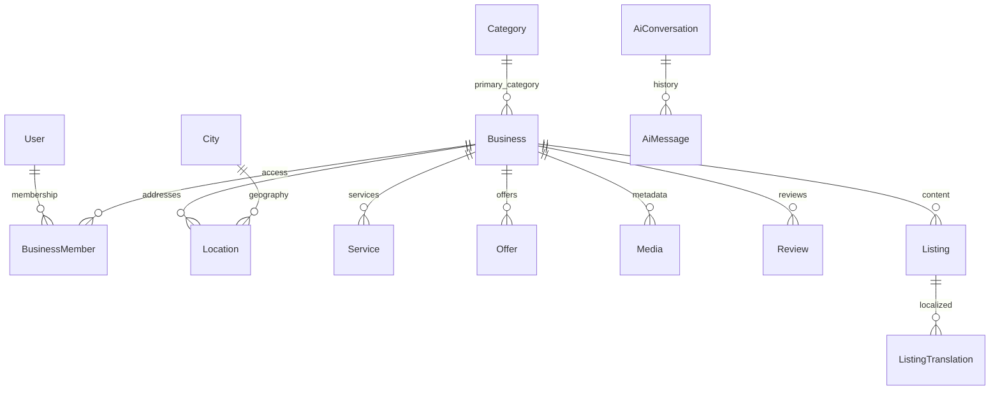

# REGA24 system map

Last verification: **2026-10-25 UTC**. Repository baseline: `e8e2b69b0d3da1e88cf75e904cf6ff4a4e8b90a8`.

Read [troubleshooting](REGA24_TROUBLESHOOTING.md) for incidents and [generated inventory](docs/REGA24_INVENTORY.md) for exact dependency ranges, API files, environment names, models and source fingerprints. Existing decisions/history remain in [PROJECT_MEMORY.md](PROJECT_MEMORY.md), [CLAUDE.md](CLAUDE.md) and the [central memory hub](https://docs.google.com/document/d/1pp6GW-UM9AQ9TuUJHumziaujxB6ZOza5S3xwA6dmxu4/edit). This map indexes that documentation layer; it does not create another decision log.

**Evidence vocabulary:** **VERIFIED (repository)** = directly inspected tracked source at the baseline; proves implementation/configuration, not deployment. **VERIFIED (live)** = successful read-only provider API on the verification date. **REPORTED** = existing memory/documentation, not freshly independently confirmed. **UNKNOWN** = not accessed or not established. A configured key does not prove valid credentials, delivery, quota, billing or end-to-end functionality.

## 1. Official project identity

- **VERIFIED (repository + GitHub):** REGA Platform / Rega24; repository [rebar9988-max/Rega](https://github.com/rebar9988-max/Rega), package `rega-platform`, default/production branch `main`. GitHub metadata and remote agree; local identity guard passed. Audit authoring branch: `docs/rega24-system-map-20261025`.
- Canonical website: `https://www.rega24.com`, defined in [site configuration](src/config/site.ts), [Next configuration](next.config.ts) and [environment schema](src/lib/env.ts).
- REGA and the separate R&L project are isolated. Never operate on R&L resources. Run `node scripts/project-identity-guard.mjs --project REGA` before edits, checks and commits; follow [AGENTS.md](AGENTS.md).
- **UNKNOWN:** legal operator identity and individual operational/on-call assignments. Do not infer legal ownership from a GitHub username or an account display name.

## 2. Architecture diagram

Solid arrows describe verified source/configuration; dashed arrows require endpoint/functional confirmation. Cloudflare custom-domain, Worker and R2 resources themselves were read live.

There is no verified R2 binding on the web Worker: media uses S3 HTTP credentials. There is no live Hyperdrive or Worker service binding in the inspected settings. Python is contacted over HTTP, not an internal service binding.

## 3. Service inventory and ownership

Operational control plane identifiers are locators, not credentials. Named human maintainers beyond the repository owner are **UNKNOWN**.

| Service | Status and locator | Responsibility / control plane |
| --- | --- | --- |
| GitHub | VERIFIED live `rebar9988-max/Rega`, public, default `main` | Source, workflows and review; repository owner `rebar9988-max` |
| Cloudflare account | VERIFIED live `ee07860dbb8e61ff6915758785baf89a` | REGA resources below only; account also contains unrelated projects |
| Web Worker | VERIFIED live `rega-platform`, compatibility `2026-09-01`, Node compatibility | Next.js web/API, auth, DB, media client, gateway; Cloudflare Workers |
| Python Worker | VERIFIED live `rega-ai-python`, compatibility `2026-10-06`, `python_workers`, `AI` binding | Optional rerank/embedding/text processing; Cloudflare Workers AI |
| Neon | VERIFIED live project `Rega24`, ID `lucky-glitter-73195208`, AWS `eu-central-1`, PostgreSQL 18 | Relational data; project ID matches [preview workflow](.github/workflows/neon-branch.yml) |
| Neon production branch | VERIFIED live `production`, `br-floral-hall-b22rpgrw`, default/primary, ready, `protected:false` | Runtime URL-to-branch match UNKNOWN; no connection strings read |
| Media | VERIFIED live R2 `rega-media`; enabled custom domain `media.regaplatform.com` | Object bytes; S3 endpoint/public URL/bucket agree with selected non-secret Worker configuration |
| Mail | VERIFIED repository Resend integration; VERIFIED live `EMAIL_PROVIDER=resend` and key binding exists | Resend dashboard delivery, domain verification and account owner UNKNOWN this audit |
| LLM providers | VERIFIED source Gemini, xAI, OpenAI, Groq, DeepSeek, OpenRouter, Anthropic adapters/config | Live Gemini/Groq/OpenAI/xAI key names present; validity/quotas/accounts UNKNOWN |
| Social login | VERIFIED repository three optional providers; live Google ID/secret names present | Facebook/Apple bindings absent in inspected settings; actual login/callback registration UNKNOWN |
| Maps/geocoding | VERIFIED repository MapLibre, configurable basemap and Nominatim | External availability/usage constraints UNKNOWN; [map config](src/lib/map-config.ts), [geocoder](src/lib/geocoder.ts) |
| Monitoring | VERIFIED repository existing Actions checks and structured logs; live Worker logs enabled | No new monitoring subscription created; billing/subscription status UNKNOWN |

## 4. Source-code folder mapping

| Component / problem | Start here |
| --- | --- |
| Localized public pages, directory, business profiles | [src/app](src/app), especially `[locale]`; API handlers in [src/app/api](src/app/api) |
| Admin/dashboard, staff actions, sign-in code UI | [src/app/dr](src/app/dr); owner entry [src/app/owner-login](src/app/owner-login) |
| Business, auth, content, review and contact features | [src/features](src/features) |
| Reusable components and styling | [src/components](src/components), [globals.css](src/app/globals.css), [public](public) |
| Shared server services | [src/lib](src/lib), [API error mapping](src/lib/api.ts), [environment schema](src/lib/env.ts) |
| Auth/session/security | [auth config](src/auth.config.ts), [auth entry](src/auth.ts), [RBAC](src/lib/rbac.ts), [business access](src/lib/business-access.ts), [rate limits](src/lib/rate-limit.ts) |
| Search / AI | [search](src/lib/search), [AI gateway](src/lib/ai/gateway.ts), [AI chat](src/lib/ai/chat.ts), [Python runtime client](src/lib/ai/python-runtime.ts) |
| Locales / text / site sections | [src/config](src/config), [src/i18n](src/i18n), [src/messages](src/messages), [middleware](src/middleware.ts) |
| Models / migrations / base seed | [schema](prisma/schema.prisma), [migrations](prisma/migrations), [seed](prisma/seed.ts) |
| Worker build / wrapper / caching | [wrangler.jsonc](wrangler.jsonc), [worker.mjs](worker.mjs), [OpenNext config](open-next.config.ts), [Next config](next.config.ts), [edge cache](src/lib/edge-cache.ts) |
| Python engine / model bindings / tests | [services/ai-python](services/ai-python), [Python app](services/ai-python/src/app.py), [Python Wrangler](services/ai-python/wrangler.jsonc) |
| Release automation / diagnostics / tests | [.github/workflows](.github/workflows), [scripts](scripts), [tests](tests), [browser tests](tests/e2e) |
| Historical architecture / decisions / recovery | [architecture](docs/ARCHITECTURE.md), [ADRs](docs/adr), [deployment](docs/DEPLOYMENT.md), [backup/restore](docs/BACKUP-RESTORE.md) |

## 5. Service dependencies

**VERIFIED (repository):** Next.js/React App Router with next-intl (ckb, kmr, de, en, fa, ar, tr), Auth.js v5, Prisma 6 driver adapters, pg, OpenNext Cloudflare, AWS S3 SDK, Zod, MapLibre. Exact declared ranges live in [package.json](package.json); resolved versions in [package-lock.json](package-lock.json); see generated inventory. Python dependencies live in [pyproject.toml](services/ai-python/pyproject.toml).

Core reads depend on database readiness; missing AI or optional Python reranking must not take down ordinary directory access. [Python reranking](src/lib/ai/python-runtime.ts) returns original candidates on service failure. The gateway uses database retrieval as facts, routing, per-provider fallback and budget limits; provider configuration is not proof a model call succeeds. Mail is required for real verification/reset/admin-code delivery. Storage config is required for new media, independent of public page rendering.

Auth uses bcrypt credentials/JWT sessions, environment-gated social providers, database role/status revalidation and membership checks. [Session policy](src/features/auth/session-policy.ts) handles password/session rules; older memory claiming no session revocation must not override this source. Admin `/dr` codes now exist: HMAC protected, 5-minute expiry, allowlisted active verified super-admin, cooldown/attempt/audit-backed durable limits in [admin-code-core](src/features/auth/admin-code-core.ts). Older “no OTP” notes are historical. Public verification/reset use [single-use link tokens](src/features/auth/tokens.ts). Do not enable OAuth linking, grant roles, weaken limits or rotate AUTH_SECRET as routine diagnostics.

[Security headers/CSP](next.config.ts), permission checks, honeypots, [private-read authorization](src/lib/dr-auth.ts) and shared Cloudflare limiters protect requests. Logger metadata redaction is key-based; arbitrary free-form exception strings and direct auth console logs are not guaranteed sanitized. Never paste raw logs, signed URLs, callback queries, tokens or provider settings responses into docs.

## 6. Database and storage relationships

**VERIFIED (repository):** Prisma `postgresql` datasource reads `DATABASE_URL`, migrations use `DIRECT_DATABASE_URL`. Workers alias `db.ts` to [db.workers.ts](src/lib/db.workers.ts): WASM client shared per isolate, pg pools per request (max 3), short idle closure, `waitUntil` cleanup. Optional HYPERDRIVE takes precedence when bound; absent in live settings. Node uses [db.ts](src/lib/db.ts).

Other models (accounts, sessions, codes, audit, settings, flags, pages, geography/translations, job/event/guide details, reports, messages, AI usage) are indexed in the generated inventory. Diagram is a navigation subset; [schema](prisma/schema.prisma) owns exact constraints/cardinalities.

[Media model](prisma/schema.prisma) stores storageKey/public URL/type/size/dimensions and optional business/service association. R2 stores bytes, not relational data. Business holds logoUrl, coverUrl and photos array. [Business-image endpoint](src/app/api/v1/media/business-image/route.ts) checks permission/ownership, normalizes images, uploads server-side then creates metadata (best-effort object cleanup if metadata creation fails). [Generic upload URL endpoint](src/app/api/v1/media/upload-url/route.ts) issues short-lived signed S3 PUT URLs (300 seconds in storage code), requiring browser CORS. SQL FK cascades do not themselves prove object deletion in R2.

**VERIFIED live:** 10 Neon branches listed (ready + archived); production not protected. **UNKNOWN:** exact runtime endpoint/branch match, current migration ledger, database records, object integrity, restorable backup and retention effectiveness. No SQL, dump, restore, object write/delete or new branch was performed. Prior successful migrations/backup claims are REPORTED in memory only.

## 7. Production domains and routing

| Host/rule | Evidence / status |
| --- | --- |
| `www.rega24.com`, `rega24.com` | VERIFIED live enabled custom domains → `rega-platform`, production; zone `8428220bdbf9049138d0607d0e3bcb9d`, active/full |
| Apex → www, preserving path/query | VERIFIED repository 301 in Next config; root locale handling in middleware (default ckb). HTTP chain not fetched this audit |
| `regaplatform.com`, `www.regaplatform.com` | VERIFIED live still enabled custom domains on same Worker; historical docs call the old host retired. Do not delete; redirect behavior UNKNOWN |
| `media.regaplatform.com` | VERIFIED live enabled on `rega-media`, SSL/ownership active; Worker MEDIA_PUBLIC_URL agrees; managed r2.dev endpoint disabled |
| DNS | VERIFIED live apex/www proxied AAAA `100::`, provider-managed origin Worker records; no classic Worker routes for rega24 zone (custom domains handle routing) |
| Nameservers | VERIFIED live `autumn.ns.cloudflare.com`, `max.ns.cloudflare.com` |
| SSL/TLS | VERIFIED live zone SSL mode `full`, Always Use HTTPS `on`, active certificate packs for apex/www/wildcards; do not infer billing from certificate pack type |
| Mail DNS | VERIFIED live Cloudflare inbound MX, SPF/DKIM records; send subdomain MX/SPF and Resend DKIM/CNAME present. Delivery/DMARC policy not established |

Routes are dashboard-managed rather than declared in root Wrangler. Do not assume a route-free Wrangler file means the site is unrouted. See [DNS procedure](REGA24_TROUBLESHOOTING.md#incident-dns-and-ssl).

## 8. Environment variable names and locations

Full **names-only** table and source locations: [generated inventory](docs/REGA24_INVENTORY.md). Source schema is [src/lib/env.ts](src/lib/env.ts); example names in [.env.example](.env.example) are not real production configuration. Local development uses ignored `.env`/`.dev.vars` as appropriate; ignored files were not inspected.

| Group | Important names | Authoritative location / notes |
| --- | --- | --- |
| Database | `DATABASE_URL`, `DIRECT_DATABASE_URL` | Worker runtime secret vs protected Actions migration secret; exact URL never document |
| Auth | `AUTH_SECRET`, `AUTH_URL`, `AUTH_GOOGLE_ID`, `AUTH_GOOGLE_SECRET`, `AUTH_FACEBOOK_ID`, `AUTH_FACEBOOK_SECRET`, `AUTH_APPLE_ID`, `AUTH_APPLE_SECRET`, `AUTH_SESSION_REVALIDATE_MS`, `AUTH_LOGIN_ATTEMPTS` | Worker runtime; schema/config and optional provider setup; never publish secrets |
| Deployment/build | `CLOUDFLARE_API_TOKEN`, `CLOUDFLARE_ACCOUNT_ID`, `REGA_TARGET`, `NEXT_TELEMETRY_DISABLED`, `CANONICAL_HOST`, `NODE_ENV`, `APP_ENV` | Actions Secrets/Variables, build environment or runtime as code requires; [workflows](.github/workflows) |
| Media | `STORAGE_ENDPOINT`, `STORAGE_REGION`, `STORAGE_BUCKET`, `STORAGE_ACCESS_KEY_ID`, `STORAGE_SECRET_ACCESS_KEY`, `MEDIA_PUBLIC_URL`, `MEDIA_PUBLIC_HOST` | Worker runtime; image remotePatterns/CSP also depend on build configuration |
| AI | `AI_PROVIDER`, `AI_PROVIDER_ORDER`, `AI_ROUTING`, `AI_TIMEOUT_MS`, `AI_DAILY_LIMIT`, `AI_SERVICE_URL`, `AI_SERVICE_TOKEN`, `AI_SERVICE_TIMEOUT_MS`; provider `*_API_KEY`, `*_MODEL`, `*_BASE_URL` | Runtime gateway and Python HTTP client; Python also has `AI_EMBEDDING_MODEL`, `AI_RERANK_MODEL`, `AI` binding |
| Mail/logging | `EMAIL_PROVIDER`, `RESEND_API_KEY`, `EMAIL_FROM`, `CONTACT_INBOX`, `LOG_LEVEL`, `ERROR_WEBHOOK_URL` | Worker runtime; webhook optional, absent in observed binding list |
| Content/legal/maps | `SECTIONS_ENABLED`, `SECTIONS_DISABLED`, `LEGAL_*`, `GEOCODING_PROVIDER`, `GEOCODING_URL`, `GEOCODING_TIMEOUT_MS`, `NEXT_PUBLIC_MAP_STYLE_URL` | Exact consumed names/locations in inventory; public-prefixed values may be bundled into browser |
| CI/seed | `NEON_API_KEY`, `SEED_ADMIN_EMAIL`, `SEED_ADMIN_PASSWORD`, test-only environment controls | Protected GitHub configuration or isolated CI; never use tests/seed to repair production blindly |

**VERIFIED live web secret_text names:** `AI_SERVICE_TOKEN`, `AI_SERVICE_URL`, `AUTH_GOOGLE_ID`, `AUTH_GOOGLE_SECRET`, `AUTH_SECRET`, `DATABASE_URL`, `GEMINI_API_KEY`, `GROQ_API_KEY`, `Regaplatform`, `RESEND_API_KEY`, `STORAGE_ACCESS_KEY_ID`, `STORAGE_SECRET_ACCESS_KEY`. `Regaplatform` purpose UNKNOWN; do not remove it. **Credential names incorrectly typed plain_text:** `OPENAI_API_KEY`, `XAI_API_KEY`; no values retrieved into documentation. Other plain configuration: contact/mail/media/storage fields and NODE_ENV. Python has secret_text `AI_SERVICE_TOKEN`, plus AI/models. These are observations, not a recommended configuration template.

Structural live web bindings: `ASSETS`, `CF_VERSION_METADATA`, `LOGIN_LIMITER`, `AI_LIMITER`, `SEARCH_LIMITER`, `FORM_LIMITER`. Runtime secrets differ from Workers Builds environment and GitHub Secrets; changing one does not propagate everywhere. [Manual sync workflow](.github/workflows/worker-secrets-sync.yml) copies only listed nonempty values; it is not a complete runtime inventory. Root `keep_vars:true` preserves dashboard variables on deploy. GitHub secret presence/permissions and build-variable settings were not enumerated.

## 9. Deployment pipeline

**VERIFIED (repository):** [CI](.github/workflows/ci.yml) runs on PR/main/manual, uses disposable Postgres, Python tests, Prisma generation/migrations/preflight, lint/typecheck/unit, Node build/E2E, Workers build/dry-run and runtime smoke tests. [Deploy](.github/workflows/deploy.yml) listens for successful main CI via workflow_run and checks out its exact SHA; manual workflow_dispatch fallback bypasses that automatic CI condition. Do not dispatch during this documentation task. Main pushes can deploy even if they only change docs.

[Python deploy](.github/workflows/ai-python-deploy.yml) separately triggers on selected main paths/manual; tests then pywrangler deploy/secrets/smoke/configuration. It is not behind the web CI completion gate. [Database migrate](.github/workflows/db-migrate.yml) is manual main-only with `migrate` and `backup-verified` confirmations; includes seed. [Secrets sync](.github/workflows/worker-secrets-sync.yml) is manual main-only with `sync`. These actions mutate production; not incident probes.

[Neon PR integration](.github/workflows/neon-branch.yml) creates expiring preview branches and has close cleanup; do not trigger it for this task or delete branches to resolve quota. Core CI uses disposable local Postgres independently. **REPORTED:** Workers Builds production dry-run, preview commands, historical branch failures and release holds in central memory. **UNKNOWN this audit:** live Builds configuration, current branch protection/check requirements and latest CI conclusions. Do not promote these reports to verified facts.

**VERIFIED live deployment readback:** web deployment `5d6f039c-01b9-4384-8bde-6a6da9daaf54`, version `79627fce-fc09-4df7-9094-3e8c401f2b6a`, 100%, created `2026-10-24T17:14:30.208477Z`; Python deployment `1175d188-3fac-4cfd-992b-47dd500fa763`, version `ce53715f-a13a-459c-a7b0-ecd6130e74e2`, 100%, created `2026-10-23T18:24:17.685703Z`. Source reports Wrangler; no build SHA mapping or functional health is inferred.

## 10. Monitoring and debugging entry points

- [Health API](src/app/api/v1/health/route.ts): `/api/v1/health`, alias [api/health](src/app/api/health/route.ts). No-store; 200/503 reflects DB reachability, migration-history sanity and required content columns. Auth/storage/email/AI fields are configuration checks, not end-to-end tests. “Migrations true” does not prove every committed migration is applied.
- **VERIFIED live:** both Workers observability/logs enabled, persisted invocation logs, traces off, logpush false; query-string redaction false. Restrict log access and redact before sharing.
- [Logger](src/lib/logger.ts) emits JSON; optional error webhook is best-effort and not guaranteed durable. [API errors](src/lib/api.ts), [DB errors](src/lib/api-types.ts), [instrumentation](src/instrumentation.ts), route error boundaries and [audit](src/lib/audit.ts) are diagnostic entry points.
- [Database preflight](scripts/database-preflight.mjs) / [workflow](.github/workflows/database-preflight.yml): read-only schema/history diagnosis, not backup proof. Requires protected DB configuration; do not print it.
- Existing [Beta health](.github/workflows/production-health.yml) hourly at minute 17 and after CI/manual; [production browser checks](.github/workflows/production-browser.yml), [Cloudflare diagnostics](.github/workflows/cloudflare-diagnostics.yml) and [health scripts](scripts/health). Read prior results first; do not start paid tooling or new remote runs unnecessarily.
- [Unit tests](tests), [E2E safety](tests/e2e/database-safety.ts), [Playwright config](playwright.config.ts) and [backup runbook](docs/BACKUP-RESTORE.md). Only isolated databases for mutation tests.

## 11. Known technical risks and blockers

| Priority | Finding and evidence | Safe next step |
| --- | --- | --- |
| High | VERIFIED live OpenAI/xAI credential bindings are plain_text; central memory also reports prior exposure, remediation unverified | Owner-controlled secure rotation/revocation and secret_text storage; inspect names/types only; do not dump settings values |
| High | VERIFIED live R2 CORS permits only old www/apex regaplatform.com origins; generic browser PUT on rega24.com may fail | Reproduce generic preflight from canonical host, then narrowly add canonical origins under separate change; server-side business-image uploads do not use browser R2 CORS |
| High | REPORTED central-memory release hold for other feature work: backup/isolated restore, key containment, Neon CI/quota and billing proof unresolved | Read latest central log before release; this audit does not clear gates or merge/deploy unrelated work |
| Medium | VERIFIED live 10 Neon branches, production `protected:false`; quota ceiling/free-plan status not reverified | Check quota read-only before any creation; never delete backup/branches to make room |
| Medium | VERIFIED live legacy website custom domains still enabled; old “retired” wording incomplete | Preserve domains; separately verify redirect/canonical behavior |
| Medium | VERIFIED repository optional manual deploy bypass and separate Python push-deploy path | Review exact source/current CI before any release; do not dispatch as a fix for docs |
| Medium | VERIFIED source separate edge cache (300-second TTL + SWR), CPU/1102 history documented in code; plain logs may contain unredacted strings | Diagnose cache headers, version and DB pooling before increasing resources or purging globally |
| Unknown | Current backup restoration, provider billing/quotas, actual OTP/social login delivery, current applied ledger, public HTTP performance, external service health | Targeted read-only evidence or authorized isolated validation; never claim confirmed from configured names |

## 12. Last verification date and evidence

Audit date **2026-10-25 UTC**. Evidence is bounded to reads performed this session; re-check before production work.

| Evidence | Method / result | Limits |
| --- | --- | --- |
| Repository identity/configuration | Local HEAD above, clean starting tree, remote GitHub URL, guard PASS; source files linked throughout | Authored docs branch only; no source/runtime edits |
| GitHub | Connector get_repo confirms repo/default main; fetch_file main root Wrangler agrees with local excerpt (blob `79f0c6d31b1638c420eea26ab3be5adfc93c23de`) | Not a full latest-main comparison or CI audit |
| Central memory | Google Drive fetch of exact linked hub, read current identity and latest checkpoint/release blockers | Historical entries are reports unless independently rechecked |
| Cloudflare Workers | Read-only GET account list; `/accounts/{account}/workers/scripts/{rega-platform,rega-ai-python}/settings` and `/deployments`, HTTP 200 | Returned bindings projected to names/types before output; only selected public storage/mail values read; no key values documented |
| Domains/storage | GET `/accounts/{account}/workers/domains`, `/r2/buckets`, `/r2/buckets/rega-media/domains/{custom,managed}`, `/cors`, HTTP 200 | No unrelated project mutation; no object-content reads or upload tests |
| DNS/TLS | GET `/zones?name=rega24.com`, zone `/dns_records`, `/settings/ssl`, `/settings/always_use_https`, `/workers/routes`, `/ssl/certificate_packs`, HTTP 200 | Control plane state, not independent browser/TLS handshake or DNS propagation measurement |
| Neon | list_projects search Rega and list_branches explicit matching project ID | Metadata only, no connection string or SQL; exact runtime branch relationship not externally verified |
| Executor | Cloud Environment status: current/enforced restricted network, no injected secrets/runtime identities; policy inspected | Website not allowed by current executor policy; no direct public fetch claimed |

Maintenance: `node scripts/rega24-docs.mjs --write` regenerates inventory from tracked source; `node scripts/rega24-docs.mjs --check` validates drift, document structure and local links/anchors offline. Stage new source files first so git ls-files includes them. [Docs validation workflow](.github/workflows/docs-check.yml) runs the same check on PR/manual, uses no secrets/dependencies/services, and deploys nothing. External links, Mermaid rendering, secrets validity and live service freshness require separate verification. Update this map and the runbook after verified infrastructure/dependency changes; retain dated evidence and unresolved issues. Do not fabricate a new live verification date when only regenerating inventory.
