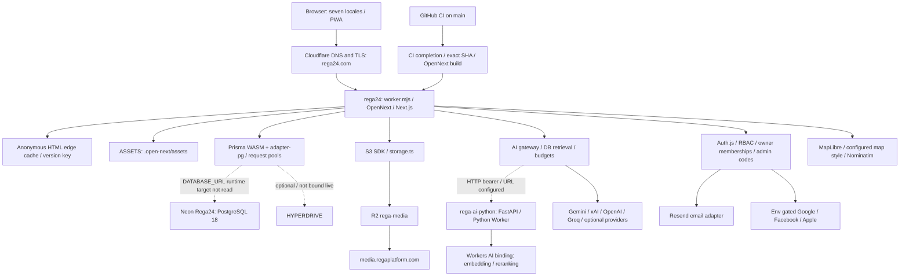
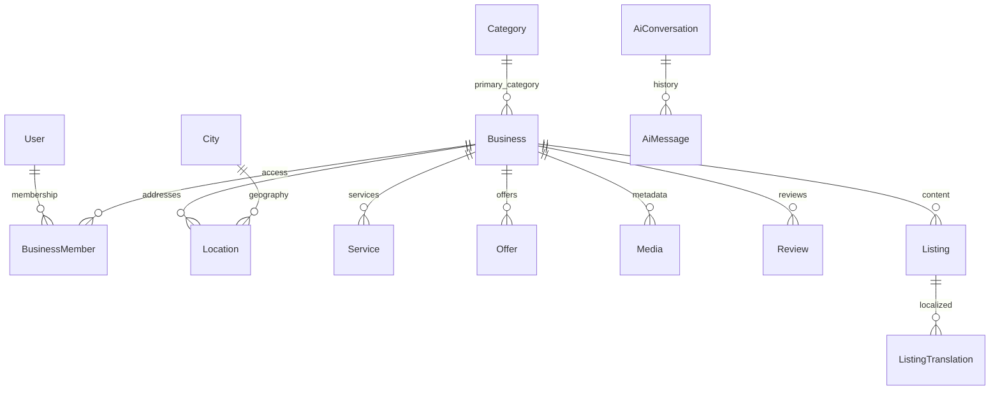

# REGA24 system map

Last verification: **2026-10-26 UTC** (continued consolidation checkpoint below). Initial audit baseline: `e8e2b69b0d3da1e88cf75e904cf6ff4a4e8b90a8`. Prepared application/pipeline source checkpoint: `ddcd06e8dc159685089521adc6bad948b75af128` (PR73). Dated historical checkpoints below are explicitly superseded where newer evidence exists.

Read [troubleshooting](REGA24_TROUBLESHOOTING.md) for incidents and [generated inventory](docs/REGA24_INVENTORY.md) for exact dependency ranges, API files, environment names, models and source fingerprints. Existing decisions/history remain in [PROJECT_MEMORY.md](PROJECT_MEMORY.md), [CLAUDE.md](CLAUDE.md) and the [central memory hub](https://docs.google.com/document/d/1pp6GW-UM9AQ9TuUJHumziaujxB6ZOza5S3xwA6dmxu4/edit). This map indexes that documentation layer; it does not create another decision log.

**Evidence vocabulary:** **VERIFIED (repository)** = directly inspected tracked source at the named checkpoint; proves implementation/configuration, not deployment. **VERIFIED (live)** = successful read-only provider API on the verification date. **REPORTED** = existing memory/documentation, not freshly independently confirmed. **UNKNOWN** = not accessed or not established. A configured key does not prove valid credentials, delivery, quota, billing or end-to-end functionality.

## 1. Official project identity

- **VERIFIED (repository + GitHub):** REGA Platform / Rega24; repository [rebar9988-max/Rega](https://github.com/rebar9988-max/Rega), package `rega-platform`, default/production branch `main`. GitHub metadata and remote agree; local identity guard passed. Initial audit branch: `docs/rega24-system-map-20261025`; prepared consolidation branch: `feat/rega24-central-admin-20261025`.
- Canonical website: `https://www.rega24.com`; reviewed non-secret identity/service ownership now comes from [project manifest](src/config/project.json), consumed by [site configuration](src/config/site.ts), [Next configuration](next.config.ts) and [environment schema](src/lib/env.ts).
- REGA and the separate R&L project are isolated. Never operate on R&L resources. Run `node scripts/project-identity-guard.mjs --project REGA` before edits, checks and commits; follow [AGENTS.md](AGENTS.md).
- **UNKNOWN:** legal operator identity and individual operational/on-call assignments. Do not infer legal ownership from a GitHub username or an account display name.

## 2. Architecture diagram

Solid arrows describe prepared branch source/configuration; dashed arrows require endpoint/functional confirmation. Main still targets retired rega-platform until reviewed reconciliation is merged; never deploy it unchanged. Cloudflare custom-domain, Worker and R2 resources themselves were read live.

There is no verified R2 binding on the web Worker: media uses S3 HTTP credentials. There is no live Hyperdrive or Worker service binding in the inspected settings. Python is contacted over HTTP, not an internal service binding.

## 3. Service inventory and ownership

Operational control plane identifiers are locators, not credentials. Named human maintainers beyond the repository owner are **UNKNOWN**.

| Service | Status and locator | Responsibility / control plane |
| --- | --- | --- |
| GitHub | VERIFIED live `rebar9988-max/Rega`, public, default `main` | Source, workflows and review; repository owner `rebar9988-max` |
| Cloudflare account | VERIFIED live `ee07860dbb8e61ff6915758785baf89a` | REGA resources below only; account also contains unrelated projects |
| Web Worker | VERIFIED live `rega24` (same stable tag `7b845cda2ee749c89c4f9b83490609b4`; old rega-platform endpoint 404), compatibility `2026-09-01`, Node compatibility | Next.js web/API, auth, DB, media client, gateway; Cloudflare Workers |
| Python Worker | VERIFIED live `rega-ai-python`, compatibility `2026-10-06`, `python_workers`, `AI` binding | Optional rerank/embedding/text processing; Cloudflare Workers AI |
| Neon | VERIFIED live project `Rega24`, ID `lucky-glitter-73195208`, AWS `eu-central-1`, PostgreSQL 18 | Relational data; project ID matches [preview workflow](.github/workflows/neon-branch.yml) |
| Neon production branch | VERIFIED live `production`, `br-floral-hall-b22rpgrw`, default/primary, ready, `protected:false` | Runtime URL-to-branch match UNKNOWN; no connection strings read |
| Media | VERIFIED live R2 `rega-media`; enabled custom domain `media.regaplatform.com` | Object bytes; S3 endpoint/public URL/bucket agree with selected non-secret Worker configuration |
| Mail | VERIFIED repository Resend integration; VERIFIED live `EMAIL_PROVIDER=resend` and key binding exists | VERIFIED live canonical rega24.com and legacy regaplatform.com sending domains verified/enabled; actual delivery and billing UNKNOWN |
| LLM providers | VERIFIED source Gemini, xAI, OpenAI, Groq, DeepSeek, OpenRouter, Anthropic adapters/config | Live Gemini/Groq/OpenAI/xAI key names present; validity/quotas/accounts UNKNOWN |
| Social login | VERIFIED repository three optional providers; live Google ID/secret names present | Facebook/Apple bindings absent in inspected settings; actual login/callback registration UNKNOWN |
| Maps/geocoding | VERIFIED repository MapLibre, configurable basemap and Nominatim | External availability/usage constraints UNKNOWN; [map config](src/lib/map-config.ts), [geocoder](src/lib/geocoder.ts) |
| Legacy Worker candidate | VERIFIED live `rega`, no custom domains, no Builds triggers, workers.dev/previews enabled | Not disabled: callers/dependencies and rollback proof remain UNKNOWN |
| Monitoring | VERIFIED repository existing Actions checks and structured logs; live Worker logs enabled | No new monitoring subscription created; billing/subscription status UNKNOWN |

## 4. Source-code folder mapping

| Component / problem | Start here |
| --- | --- |
| Localized public pages, directory, business profiles | [src/app](src/app), especially `[locale]`; API handlers in [src/app/api](src/app/api) |
| Canonical `/admin` office, staff actions, sign-in code UI | [src/app/admin](src/app/admin); owner entry [src/app/owner-login](src/app/owner-login) |
| Business, auth, content, review and contact features | [src/features](src/features) |
| Reusable components and styling | [src/components](src/components), [globals.css](src/app/globals.css), [public](public) |
| Database ownership diagnostic | [database-identity.ts](src/lib/database-identity.ts), public endpoint metadata in [manifest](src/config/project.json); runtime result is boolean only |
| Shared server services | [src/lib](src/lib), [API error mapping](src/lib/api.ts), [environment schema](src/lib/env.ts) |
| Auth/session/security | [auth config](src/auth.config.ts), [auth entry](src/auth.ts), [RBAC](src/lib/rbac.ts), [business access](src/lib/business-access.ts), [rate limits](src/lib/rate-limit.ts) |
| Search / AI | [search](src/lib/search), [AI gateway](src/lib/ai/gateway.ts), [AI chat](src/lib/ai/chat.ts), [Python runtime client](src/lib/ai/python-runtime.ts) |
| Locales / text / site sections | [src/config](src/config), [src/i18n](src/i18n), [src/messages](src/messages), [middleware](src/middleware.ts) |
| Models / migrations / base seed | [schema](prisma/schema.prisma), [migrations](prisma/migrations), [seed](prisma/seed.ts) |
| Worker build / wrapper / caching | [wrangler.jsonc](wrangler.jsonc), [worker.mjs](worker.mjs), [OpenNext config](open-next.config.ts), [Next config](next.config.ts), [edge cache](src/lib/edge-cache.ts) |
| Python engine / model bindings / tests | [services/ai-python](services/ai-python), [Python app](services/ai-python/src/app.py), [Python Wrangler](services/ai-python/wrangler.jsonc) |
| Release automation / diagnostics / tests | [.github/workflows](.github/workflows), [scripts](scripts), [tests](tests), [browser tests](tests/e2e) |
| Historical architecture / decisions / recovery | [architecture](docs/ARCHITECTURE.md), [ADRs](docs/adr), [deployment](docs/DEPLOYMENT.md), [backup/restore](docs/BACKUP-RESTORE.md) |

## 5. Service dependencies

**VERIFIED (repository):** Next.js/React App Router with next-intl (ckb, kmr, de, en, fa, ar, tr), Auth.js v5, Prisma 6 driver adapters, pg, OpenNext Cloudflare, AWS S3 SDK, Zod, MapLibre. Exact declared ranges live in [package.json](package.json); resolved versions in [package-lock.json](package-lock.json); see generated inventory. Python dependencies live in [pyproject.toml](services/ai-python/pyproject.toml).

Core reads depend on database readiness; missing AI or optional Python reranking must not take down ordinary directory access. [Python reranking](src/lib/ai/python-runtime.ts) returns original candidates on service failure. The gateway uses database retrieval as facts, routing, per-provider fallback and budget limits; provider configuration is not proof a model call succeeds. Mail is required for real verification/reset/admin-code delivery. Storage config is required for new media, independent of public page rendering.

Auth uses bcrypt credentials/JWT sessions, environment-gated social providers, database role/status revalidation and membership checks. [Session policy](src/features/auth/session-policy.ts) handles password/session rules; older memory claiming no session revocation must not override this source. Admin `/admin` sign-in codes exist: HMAC protected, 5-minute expiry, allowlisted active verified super-admin, cooldown/attempt/audit-backed durable limits in [admin-code-core](src/features/auth/admin-code-core.ts). Older “no OTP” notes are historical. Public verification/reset use [single-use link tokens](src/features/auth/tokens.ts). Do not enable OAuth linking, grant roles, weaken limits or rotate AUTH_SECRET as routine diagnostics.

[Security headers/CSP](next.config.ts), permission checks, honeypots, [private-read authorization](src/lib/dr-auth.ts) and shared Cloudflare limiters protect requests. Logger metadata redaction is key-based; arbitrary free-form exception strings and direct auth console logs are not guaranteed sanitized. Never paste raw logs, signed URLs, callback queries, tokens or provider settings responses into docs.

## 6. Database and storage relationships

**VERIFIED (repository):** Prisma `postgresql` datasource reads `DATABASE_URL`, migrations use `DIRECT_DATABASE_URL`. Workers alias `db.ts` to [db.workers.ts](src/lib/db.workers.ts): WASM client shared per isolate, pg pools per request (max 3), short idle closure, `waitUntil` cleanup. Optional HYPERDRIVE takes precedence when bound; absent in live settings. Node uses [db.ts](src/lib/db.ts).

Other models (accounts, sessions, codes, audit, settings, flags, pages, geography/translations, job/event/guide details, reports, messages, AI usage) are indexed in the generated inventory. Diagram is a navigation subset; [schema](prisma/schema.prisma) owns exact constraints/cardinalities.

[Media model](prisma/schema.prisma) stores storageKey/public URL/type/size/dimensions and optional business/service association. R2 stores bytes, not relational data. Business holds logoUrl, coverUrl and photos array. [Business-image endpoint](src/app/api/v1/media/business-image/route.ts) checks permission/ownership, normalizes images, uploads server-side then creates metadata (best-effort object cleanup if metadata creation fails). [Generic upload URL endpoint](src/app/api/v1/media/upload-url/route.ts) issues short-lived signed S3 PUT URLs (300 seconds in storage code), requiring browser CORS. SQL FK cascades do not themselves prove object deletion in R2.

**VERIFIED live:** 10 Neon branches listed (ready + archived); production not protected. **UNKNOWN:** exact runtime endpoint/branch match, full record/object integrity, restorable backup and retention effectiveness. Continuation used read-only aggregate SQL only; no dump, restore, object write/delete or new provider branch was performed. Verified neondb/neondb_owner, PG18.6, 14 finished/0 unfinished migrations, 3 businesses/3 memberships. Two stored active SUPER_ADMIN rows include one allowlisted owner and one non-allowlisted row; existing effectiveRole demotes the latter to USER. No roles were changed. Prior successful migrations/backup claims are REPORTED in memory only.

## 7. Production domains and routing

| Host/rule | Evidence / status |
| --- | --- |
| `www.rega24.com`, `rega24.com` | VERIFIED live October26 enabled custom domains → `rega24`, production (stable resource tag in manifest); zone `8428220bdbf9049138d0607d0e3bcb9d`, active/full |
| Apex → www, preserving path/query | VERIFIED repository 301 in Next config; root locale handling in middleware (default ckb). HTTP chain not fetched this audit |
| `regaplatform.com`, `www.regaplatform.com` | VERIFIED live still enabled custom domains on same Worker; historical docs call the old host retired. Do not delete; live redirect behavior UNKNOWN; prepared code adds canonical-preserving legacy host redirects |
| `media.regaplatform.com` | VERIFIED live enabled on `rega-media`, SSL/ownership active, minTLS `1.2`; Worker MEDIA_PUBLIC_URL agrees; managed r2.dev endpoint disabled |
| DNS | VERIFIED live apex/www proxied AAAA `100::`, provider-managed origin Worker records; no classic Worker routes for rega24 zone (custom domains handle routing) |
| Nameservers | VERIFIED live `autumn.ns.cloudflare.com`, `max.ns.cloudflare.com` |
| SSL/TLS | VERIFIED live canonical zone min TLS `1.2`, SSL mode `full`, Always Use HTTPS `on`, active certificate packs for apex/www/wildcards; do not infer billing from certificate pack type |
| Mail DNS | VERIFIED live Cloudflare inbound MX, SPF/DKIM records; send subdomain MX/SPF and Resend DKIM/CNAME present. Delivery/DMARC policy not established |

Routes are dashboard-managed rather than declared in root Wrangler. Do not assume a route-free Wrangler file means the site is unrouted. See [DNS procedure](REGA24_TROUBLESHOOTING.md#incident-dns-and-ssl).

## 8. Environment variable names and locations

Full **names-only** table and source locations: [generated inventory](docs/REGA24_INVENTORY.md). Source schema is [src/lib/env.ts](src/lib/env.ts); example names in [.env.example](.env.example) are not real production configuration. Local development uses ignored `.env`/`.dev.vars` as appropriate; ignored files were not inspected.

| Group | Important names | Authoritative location / notes |
| --- | --- | --- |
| Database | `DATABASE_URL`, `DIRECT_DATABASE_URL` | Worker runtime secret vs protected Actions migration secret; exact URL never document |
| Auth | `AUTH_SECRET`, `AUTH_URL`, `AUTH_GOOGLE_ID`, `AUTH_GOOGLE_SECRET`, `AUTH_FACEBOOK_ID`, `AUTH_FACEBOOK_SECRET`, `AUTH_APPLE_ID`, `AUTH_APPLE_SECRET`, `AUTH_SESSION_REVALIDATE_MS`, `AUTH_LOGIN_ATTEMPTS` | Worker runtime; schema/config and optional provider setup; never publish secrets |
| Deployment/build | `CLOUDFLARE_API_TOKEN`, `CLOUDFLARE_ACCOUNT_ID`, `REGA_TARGET`, `NEXT_TELEMETRY_DISABLED`, `CANONICAL_HOST`, `NODE_ENV`, `APP_ENV` | Actions Secrets/Variables, build environment or runtime as code requires; [workflows](.github/workflows) |
| Media | `STORAGE_ENDPOINT`, `STORAGE_REGION`, `STORAGE_BUCKET`, `STORAGE_ACCESS_KEY_ID`, `STORAGE_SECRET_ACCESS_KEY`, `MEDIA_PUBLIC_URL`, `MEDIA_PUBLIC_HOST` | Worker runtime; image remotePatterns/CSP also depend on build configuration |
| AI | `AI_PROVIDER`, `AI_PROVIDER_ORDER`, `AI_ROUTING`, `AI_TIMEOUT_MS`, `AI_DAILY_LIMIT`, `AI_SERVICE_URL`, `AI_SERVICE_TOKEN`, `AI_SERVICE_TIMEOUT_MS`; provider `*_API_KEY`, `*_MODEL`, `*_BASE_URL` | Runtime gateway and Python HTTP client; Python also has `AI_EMBEDDING_MODEL`, `AI_RERANK_MODEL`, `AI` binding |
| Mail/logging | `EMAIL_PROVIDER`, `RESEND_API_KEY`, `EMAIL_FROM`, `CONTACT_INBOX`, `LOG_LEVEL`, `ERROR_WEBHOOK_URL` | Worker runtime; webhook optional, absent in observed binding list |
| Content/legal/maps | `SECTIONS_ENABLED`, `SECTIONS_DISABLED`, `LEGAL_*`, `GEOCODING_PROVIDER`, `GEOCODING_URL`, `GEOCODING_TIMEOUT_MS`, `NEXT_PUBLIC_MAP_STYLE_URL` | Exact consumed names/locations in inventory; public-prefixed values may be bundled into browser |
| CI/seed | `NEON_API_KEY`, `SEED_ADMIN_EMAIL`, `SEED_ADMIN_PASSWORD`, test-only environment controls | Protected GitHub configuration or isolated CI; never use tests/seed to repair production blindly |

**VERIFIED live web secret_text names:** `AI_SERVICE_TOKEN`, `AI_SERVICE_URL`, `AUTH_GOOGLE_ID`, `AUTH_GOOGLE_SECRET`, `AUTH_SECRET`, `DATABASE_URL`, `GEMINI_API_KEY`, `GROQ_API_KEY`, `Regaplatform`, `RESEND_API_KEY`, `STORAGE_ACCESS_KEY_ID`, `STORAGE_SECRET_ACCESS_KEY`. `Regaplatform` purpose UNKNOWN; do not remove it. **VERIFIED live corrected in continuation:** `OPENAI_API_KEY`, `XAI_API_KEY` are now `secret_text`. Atomic settings patch retained all 28 bindings; no values entered documentation. Provider revocation/rotation is still unverified. Other plain configuration: contact/mail/media/storage fields and NODE_ENV. Python has secret_text `AI_SERVICE_TOKEN`, plus AI/models. These are observations, not a recommended configuration template.

Structural live web bindings: `ASSETS`, `CF_VERSION_METADATA`, `LOGIN_LIMITER`, `AI_LIMITER`, `SEARCH_LIMITER`, `FORM_LIMITER`. Runtime secrets differ from Workers Builds environment and GitHub Secrets; changing one does not propagate everywhere. [Manual sync workflow](.github/workflows/worker-secrets-sync.yml) copies only listed nonempty values; it is not a complete runtime inventory. Root `keep_vars:true` preserves dashboard variables on deploy. GitHub secret presence/permissions remain UNKNOWN. The failed branch build metadata returned no build-variable entries; runtime and inherited preview configuration are separate.

## 9. Deployment pipeline

**VERIFIED (repository):** [CI](.github/workflows/ci.yml) runs on PR/main/manual, uses disposable Postgres, Python tests, Prisma generation/migrations/preflight, lint/typecheck/unit, Node build/E2E, Workers build/dry-run and runtime smoke tests. [Deploy](.github/workflows/deploy.yml) listens for successful main CI via workflow_run and checks out its exact SHA; manual fallback is now prepared with the shared exact-main-CI verification gate; not published yet. Do not dispatch before documented release blockers are cleared. Main pushes can deploy even if they only change docs.

[Python deploy](.github/workflows/ai-python-deploy.yml) in the production baseline used an independent selected-main-path push trigger. Prepared continuation changes it to the shared successful-main-CI trigger, exact SHA checkout and main-only manual fallback, protected by [verified release](scripts/verified-release.mjs). Both gates also reject a superseded main SHA or wrong Cloudflare account. This workflow repair is not published yet. [Database migrate](.github/workflows/db-migrate.yml) is manual main-only with `migrate` and `backup-verified` confirmations; includes seed. [Secrets sync](.github/workflows/worker-secrets-sync.yml) is manual main-only with `sync`. These actions mutate production; not incident probes.

[Neon PR integration](.github/workflows/neon-branch.yml) now prepares opt-in expiring previews (`neon-preview` label); existing close cleanup is preserved. Core CI uses disposable local Postgres independently. The old automatic workflow created PR73 preview br-sparkling-thunder-b22kukdq on 2026-10-26, ready, expires November 9; no production SQL writes/deletions by this session. Do not delete branches to resolve quota. **VERIFIED live:** main Builds uses dry-run. Branch build f39a26b1-ee9d-4034-aaaf-042df45445f7 at 9276ed2 completed normal npm build, then failed wrangler preview for missing previews block. Only this branch preview now has auto_build=false and dry-run deploy command (200/readback); production unchanged by that repair. PR73 CI is running; protection requirements remain UNKNOWN. See acceptance ledger for final results.

**VERIFIED live deployment readback:** web deployment `5d6f039c-01b9-4384-8bde-6a6da9daaf54`, version `79627fce-fc09-4df7-9094-3e8c401f2b6a`, 100%, created `2026-10-24T17:14:30.208477Z`; Python deployment `1175d188-3fac-4cfd-992b-47dd500fa763`, version `ce53715f-a13a-459c-a7b0-ecd6130e74e2`, 100%, created `2026-10-23T18:24:17.685703Z`. Source reports Wrangler; no build SHA mapping or functional health is inferred.

## 10. Monitoring and debugging entry points

- [Health API](src/app/api/v1/health/route.ts): `/api/v1/health`, alias [api/health](src/app/api/health/route.ts). No-store; 200/503 reflects DB reachability, migration-history sanity and required content columns. Auth/storage/email/AI fields are configuration checks, not end-to-end tests. “Migrations true” does not prove every committed migration is applied.
- **VERIFIED live:** both Workers observability/logs enabled, persisted invocation logs, traces off, logpush false; query-string redaction true (both Workers; continuation readback). Restrict log access and redact before sharing.
- [Logger](src/lib/logger.ts) emits JSON; optional error webhook is best-effort and not guaranteed durable. [API errors](src/lib/api.ts), [DB errors](src/lib/api-types.ts), [instrumentation](src/instrumentation.ts), route error boundaries and [audit](src/lib/audit.ts) are diagnostic entry points.
- [Database preflight](scripts/database-preflight.mjs) / [workflow](.github/workflows/database-preflight.yml): read-only schema/history diagnosis, not backup proof. Requires protected DB configuration; do not print it.
- Existing [Beta health](.github/workflows/production-health.yml) hourly at minute 17 and after CI/manual; [production browser checks](.github/workflows/production-browser.yml), [Cloudflare diagnostics](.github/workflows/cloudflare-diagnostics.yml) and [health scripts](scripts/health). Read prior results first; do not start paid tooling or new remote runs unnecessarily.
- [Unit tests](tests), [E2E safety](tests/e2e/database-safety.ts), [Playwright config](playwright.config.ts) and [backup runbook](docs/BACKUP-RESTORE.md). Only isolated databases for mutation tests.

## 11. Known technical risks and blockers

| Priority | Finding and evidence | Safe next step |
| --- | --- | --- |
| High | Storage types repaired to secret_text; historical provider-key exposure still requires revocation/rotation | Owner-controlled provider rotation/revocation and protected GitHub secret replacement; never output values |
| Resolved config | VERIFIED live R2 CORS now includes canonical www/apex rega24.com plus preserved legacy origins | Control-plane readback passed; actual browser signed-upload test remains unverified live |
| High | REPORTED central-memory release hold for other feature work: backup/isolated restore, key containment, Neon CI/quota and billing proof unresolved | Read latest central log before release; this audit does not clear gates or merge/deploy unrelated work |
| Medium | VERIFIED live 10 Neon branches, production `protected:false`; free_v3/10-branch limit verified; current list changed concurrently | Check quota read-only before any creation; never delete backup/branches to make room |
| Medium | VERIFIED live legacy website custom domains still enabled; old “retired” wording incomplete | Preserve domains; separately verify redirect/canonical behavior |
| Mitigated locally | Baseline manual bypass/separate Python push-deploy path replaced by shared CI/current-main/account gate in prepared workflows | Publish only after release holds clear; PR73 CI runs are verified, but no protection bypass or application release |
| Medium | VERIFIED source separate edge cache (300-second TTL + SWR), CPU/1102 history documented in code; plain logs may contain unredacted strings | Diagnose cache headers, version and DB pooling before increasing resources or purging globally |
| Unknown | Independent backup/media restoration, provider billing/quotas, actual OTP/social login delivery, runtime URL-to-branch mapping, public HTTP performance and external service health | Targeted read-only evidence or authorized isolated validation; never claim confirmed from configured names |

### Continued consolidation checkpoint — 2026-10-25 (not an application release)

- Local work continues from documentation commit `7301bc6`, branch `feat/rega24-central-admin-20261025`.
- **VERIFIED local implementation:** one actual dashboard tree [src/app/admin](src/app/admin), canonical `/admin` and `/admin/*`; `/dr` and descendants permanently redirect with query/method preservation. The rewrite trial was removed for one real route tree. Further browser evidence identified repeated authenticated navigation/API prefetching; private sidebar prefetch is disabled and the JSON health report uses a plain anchor. Owners/staff retain existing scoped permissions. Fresh Super Admin guard protects `/admin/system`; media page scopes non-staff metadata to uploader. Native business/user/geography/category/content/AI/audit workflows are reused.
- [System settings](src/app/admin/system/actions.ts) accept only consumed public-review flag, persist change+audit atomically, reject arbitrary names and secrets. `/admin/system` shows configuration booleans, not a false live-health certification; cloud resource operations use existing linked provider consoles, not broad management credentials in the app.
- [Production manifest](src/config/project.json) centralizes official name Rega24, canonical/apex/admin routing and declared service ownership. The package name is stable; later prepared target reconciliation follows the verified rename of the same existing Worker, avoiding replacement. Environment-specific credentials stay in protected provider settings; validator detects manifest/Worker drift.
- **VERIFIED live config changes:** canonical R2 CORS origins added without removing legacy origins; OpenAI/xAI bindings converted atomically to secret_text (all 28 bindings preserved). Both Workers now redact query strings in logs, with observability/tracing settings otherwise preserved.
- **VERIFIED live October25 config deployments (historical; superseded below):** web `66929254-3e9d-4b43-b70f-34f89389f60f` / version `93023599-8b90-48a2-9449-33ea286fa34e` at 100%; Python `57283b99-066e-4dbe-a1f1-a4010a88ca27` / version `b3e29ec6-d74c-4843-8b87-c110939d1987` at 100%. These are configuration-only versions of existing application code, not the new `/admin` application release.
- **VERIFIED live:** no matching REGA Pages project in returned account project list; extra Worker `rega` has no custom domains or Builds triggers, workers.dev/previews enabled. Preserve it until actual caller/dependency/rollback verification establishes safe retirement. Python is a required module, not duplicate web hosting. Legacy media domain still serves declared storage and must remain.
- **VERIFIED local security remediation:** patched dependency overrides/Zod upgrade yield npm audit zero findings; explicit update schemas prevent Zod4 creation defaults from changing omitted PATCH fields. Auth logging now omits arbitrary provider messages/stacks in prepared code.
- **BLOCKED application deployment/100 score:** provider-key revocation/rotation unresolved; central release hold/verified production backup remains uncleared; Cloudflare Billing Read unavailable (403, no OAuth scope); current browser connector requires reauthentication; executor excludes production/font hosts and has no protected deploy/DB credentials. Neon metadata confirms free_v3 and 10-branch limit; no inference calls, paid service activation or upgrades were made. This October25 checkpoint predates the automatic PR73 preview creation recorded below. Test-only mocked-font artifacts must never be deployed.
- Verification results and precise continuation conditions: [consolidation acceptance report](docs/REGA24_CONSOLIDATION.md). No full-platform 100/100 claim.

## 12. Last verification date and evidence

Initial audit **2026-10-25 UTC**; latest control-plane/source checks **2026-10-26 UTC**. The table records initial access; the following reconciliation section supersedes old target/version/branch details. Re-check before production work.

| Evidence | Method / result | Limits |
| --- | --- | --- |
| Repository identity/configuration | Local HEAD above, clean starting tree, remote GitHub URL, guard PASS; source files linked throughout | Initial audit was documentation-only; subsequent prepared app/live configuration repairs are recorded below |
| GitHub | Connector get_repo confirms repo/default main; fetch_file main root Wrangler agrees with local excerpt (blob `79f0c6d31b1638c420eea26ab3be5adfc93c23de`) | Not a full latest-main comparison or CI audit |
| Central memory | Google Drive fetch of exact linked hub, read current identity and latest checkpoint/release blockers | Historical entries are reports unless independently rechecked |
| Cloudflare Workers | Read-only GET account list; `/accounts/{account}/workers/scripts/{rega-platform,rega-ai-python}/settings` and `/deployments`, HTTP 200 | Returned bindings projected to names/types before output; only selected public storage/mail values read; no key values documented |
| Domains/storage | GET `/accounts/{account}/workers/domains`, `/r2/buckets`, `/r2/buckets/rega-media/domains/{custom,managed}`, `/cors`, HTTP 200 | No unrelated project mutation; no object-content reads or upload tests |
| DNS/TLS | GET `/zones?name=rega24.com`, zone `/dns_records`, `/settings/ssl`, `/settings/always_use_https`, `/workers/routes`, `/ssl/certificate_packs`, HTTP 200 | Control plane state, not independent browser/TLS handshake or DNS propagation measurement |
| Neon | list_projects search Rega and list_branches explicit matching project ID | Initial read metadata-only; subsequent explicit production-branch aggregate SQL verified 14 finished/0 unfinished migrations and 3 businesses/3 memberships. No connection string read; runtime binding match UNKNOWN |
| Executor | Cloud Environment status: current/enforced restricted network, no injected secrets/runtime identities; policy inspected | Website not allowed by current executor policy; no direct public fetch claimed |

Maintenance: `node scripts/rega24-docs.mjs --write` regenerates inventory from tracked source; `node scripts/rega24-docs.mjs --check` validates drift, document structure and local links/anchors offline. Stage new source files first so git ls-files includes them. [CI](.github/workflows/ci.yml) runs the same dependency-free check through the existing `validate-system-docs.mjs` wrapper before installation. The redundant separate docs workflow was removed. `generate-system-inventory.mjs` remains a compatible command; JSON and Markdown are generated views of the same source facts. Both deployment workflows share `deploy-scope.mjs` to skip documentation-only commits. External links, Mermaid rendering, secrets validity and live service freshness require separate verification. Update this map and the runbook after verified infrastructure/dependency changes; retain dated evidence and unresolved issues. Do not fabricate a new live verification date when only regenerating inventory.

## Current live reconciliation — 2026-10-26

- **VERIFIED live superseding prior web version:** official www/apex and legacy website custom domains attach to
  `rega24`, stable tag `7b845cda2ee749c89c4f9b83490609b4`. Old `rega-platform` deployment endpoint returns 404.
  Active deployment `3010f7a1-f41d-4938-917a-7bc666e89917`, version `1a2c3a34-38d0-45fe-88d2-cd9144b0e02e`, 100%,
  created October 25 20:17:14Z. This session did not perform that rename/deployment. Exact application commit UNKNOWN.
- **VERIFIED repository, prepared:** manifest/Wrangler/identity guard/workflows now target existing `rega24`.
  [Read-only production preflight](scripts/production-target.mjs) verifies account, stable tag, required AI Worker,
  and unique production ownership of both official domains. Release gates and secret sync fail closed on drift;
  they must never recreate the retired target. Package name remains rega-platform. R&L untouched.
- **VERIFIED live:** all 28 binding names/types retained, OpenAI/xAI secret_text. The replacement active config has
  query-string redaction false on discovery; earlier privacy PASS applied to the prior version only. Never treat
  historical settings-only hardening as current proof. Provider revocation remains UNKNOWN/BLOCKED.
- **VERIFIED live:** current ten Neon branches include fresh backup br-broad-queen-b2f9p1p0, a child restore-verify
  br-proud-cloud-b2d38n80 (created by another session), and the PR73 workflow preview. Presence/ready status alone
  does not certify isolated restoration. Earlier ten-branch inventory is historical, not an unchanged resource list.
- **VERIFIED GitHub:** branch pushed; draft [PR73](https://github.com/rebar9988-max/Rega/pull/73). Main remains 7011eb5;
  its old target and unresolved security/backup/billing holds prohibit production release. See
  [acceptance evidence](docs/REGA24_CONSOLIDATION.md) for exact CI checkpoints.

2026-10-26 privacy repair after target reconciliation: settings-only update on existing rega24 succeeded HTTP200; readback redact_query_string=true and all 28 binding names/types unchanged. Active deployment cf37b341-5e5c-4703-915b-731aeefa6bfd / version f7a118cd-6f64-4206-a19e-ec5b434a5bc9 at100%. No application upload, route change or secret-value update; no new logging destination. An initial malformed multipart request was rejected400 with no change, then corrected. Rollback must preserve redaction rather than returning to a pre-hardening version.

Latest shared-hub recovery evidence (2026-10-26, REPORTED from the completed other completed session, not independently repeated here): Neon-native reconstruction compared 37public tables/2325rows with matching row/schema/index/constraint digests and14migration records; four nullable social fields were rehearsed only on the isolated restore branch, never production. Backup and restore computes were suspended. This supersedes earlier absence-of-native-proof wording; it does not certify independent PG18 dump restore, functions/grants/enums or R2 backup, and does not clear remaining release holds. Reuse that completed investigation.

Final local source-checkpoint verification at ddcd06e: full unit/integration suite 347 PASS / 0 FAIL / 0 SKIP using isolated local PostgreSQL; lint/typecheck and 18 focused pipeline/identity/ownership checks PASS. Current documentation checker: 8 documents, 388 source fingerprints, 107 environment names, 10 complete procedures. Workflow syntax parsed; reconciled Wrangler dry-run PASS using non-deployable QA artifacts. PR73 is the entry point for latest hosted CI evidence; local checks are not production certification.

October26 media TLS hardening: canonical zone already required TLS1.2. R2 custom domain media.regaplatform.com previously allowed1.0; scoped PUT updated only enabled=true/minTLS=1.2, HTTP200/readback. Ownership stayed active and bucket/objects/DNS unchanged; SSL status initializing/pending immediately after update, then active on final HTTP200 readback (2026-10-26 around02:20Z). This changes protocol support for obsolete TLS1.0/1.1 clients; supported app browsers/S3 SDK use TLS1.2+. Rollback only for verified compatibility outage through the same domain setting, never domain/bucket deletion.

R2 minimum TLS is independent of zone min_tls_version; authoritative [Cloudflare public-bucket documentation](https://developers.cloudflare.com/r2/buckets/public-buckets/) confirms the separate custom-domain API. Both official zone and media now require TLS1.2; no paid certificate feature was activated.

October26 analytics diagnosis (01:55–02:25UTC window): Cloudflare GraphQL reported337 HTTP504, all requestSource=edgeWorkerCacheAPI under the synthetic /__rega-edge-cache key namespace. Source edge-cache.ts uses cache.match; official Cloudflare Cache API documentation confirms an absent/expired item logs internal504 while returning undefined to the Worker. These were NOT evidence of client-visible outage. Excluding synthetic cache paths, returned groups contained no5xx (including1532 www200 and14apex301); these are bounded adaptive analytics, not an end-to-end journey test. Worker analytics reported1364requests/0exceptions; schema confirms CPU p50/p99 units microseconds, observed19483/650432µs (19.483/650.432ms). This is not billing/Free capacity proof or a universal latency score. Never infer plan entitlement or site downtime from unfiltered counters. Root-cause documentation: https://developers.cloudflare.com/workers/runtime-apis/cache/ and request-source filtering in Cloudflare analytics.

October26 deployment continuation after explicit owner request “Deploy100/100”: main advanced to5a9a95c (cleanup#76).
Integration preserves its verified consolidated business cards/deletions, tracked-inventory regression and dependency
updates without importing PR71 schema or PR74 page changes. Shared inventory wrapper remains canonical; the existing
untracked-artifact regression exercises it. Main's old target is still rega-platform; prepared branch targets the
verified existing rega24. Final deployment must use reviewed main, exact successful CI and live-target preflight.
CI40257680473 ended cancelled at its35-minute job limit; logs show slow Ubuntu browser-dependency installation and
E2E still running at cancellation, with no completed full-suite result. CI budget now60minutes, preserving every
check. No timeout/test assertion was weakened. Python deployment is now explicit main-only manual dispatch with the
same exact-CI/target gates: a web release must not redeploy an unchanged backend, rotate its token or start inference.
Existing Python integration is preserved. Protected API checks now reject redirects, matching focused PR75's safety
requirement. Old provider revocation, runtime DB ownership, billing and independent backup/media evidence remain
unverified; explicit deployment intent does not certify those facts or permit a false100 score.

Prepared release-proof improvements (not live until deployment): public health emits sourceSha only for a validated
40-hex commit value, never arbitrary environment text. Deploy tags/messages and non-secret REGA_COMMIT_SHA identify
reviewed source while --keep-vars preserves configuration. Post-deploy script scripts/health/release-proof.mjs checks
100% active-version tag, health/database, canonical200, apex301, legacy admin308/query preservation and anonymous
admin sign-in without an exposed sidebar. Protected provider authorization never goes to public endpoints. Existing
Beta health now runs after successful deployment, followed by the existing production browser check; no new paid
monitor. Browser verification budget45minutes accounts for the same measured slow dependency download.
Neon metadata read explicitly for lucky-glitter-73195208 maps production br-floral-hall-b22rpgrw to endpoint
 ep-autumn-glitter-b2jxzis9 and its public direct/pooled hostnames, now declared in the manifest (not credentials).
Database identity helper compares the runtime URL server-side with these hosts/database, rejecting alternate-host
query overrides and returning only a boolean. Existing health liveness semantics stay unchanged for local QA;
production release proof requires databaseTargetMatchesManifest=true. The actual runtime relationship remains
unverified until a real protected deployment serves that check. No connection string/password is retrieved or
returned to the model, documentation or public health. No database target, record, role or schema is changed.
