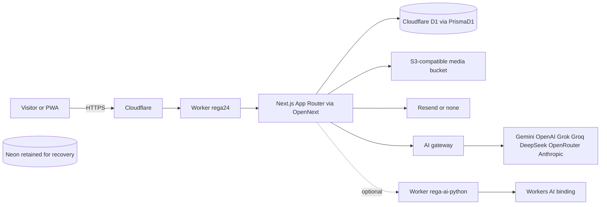
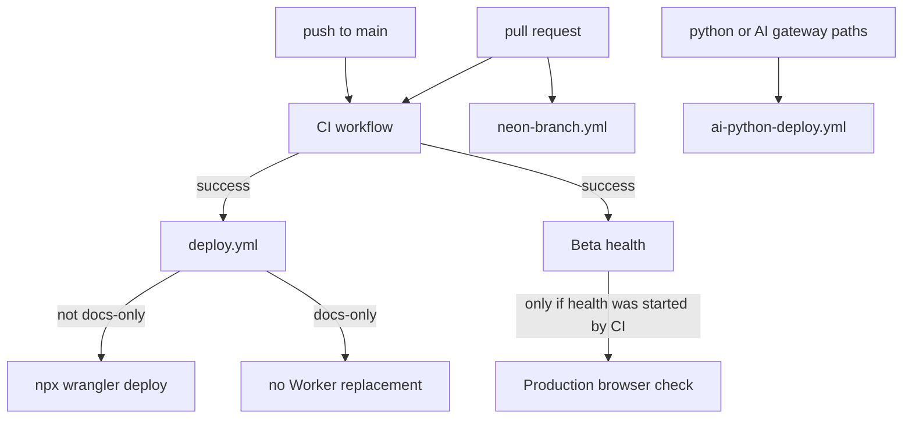

# REGA24 system map

Permanent owner platform policy: [CLAUDE.md section 0.9](CLAUDE.md#09-permanent-cloudflare-platform-mandate-owner-instruction-2026-10-28) requires D1 for the database, Workers for backend/API, R2 for files/images, and Cloudflare for deployment, DNS and security. Rechecked 2026-10-28: active Worker selects D1, its configured S3 endpoint is Cloudflare R2, the configured bucket exists in the same Cloudflare account, and `rega24.com` is an active zone with Cloudflare nameservers. This confirms the platform; it is not a new audit of every security setting.

Current verified state (2026-10-28): production `rega24` uses Cloudflare D1, existing EU `rega24-migration` / `728f792d-37b6-49f8-abc1-e81512219f7d`. All 2332 source records across 36 tables were verified before opening traffic; exact-main CI, deployment and live checks passed. Initial cutover release `09afcd538a71fff6b08627057d272bf318e4362c`; later verified active release `caac0653eed0b86b8e2498b3d7a4c490dd4baf24`, version `38a340a5-7c83-4db8-b73a-1716c3c16b40`. [Current migration evidence and procedure](docs/D1-MIGRATION.md). Later verified checkpoints supersede the original audit tables below.

Infrastructure index for REGA Platform. This file locates components. It does not replace
[CLAUDE.md](CLAUDE.md), [PROJECT_MEMORY.md](PROJECT_MEMORY.md), or the
[Google Doc hub](https://docs.google.com/open?id=1pp6GW-UM9AQ9TuUJHumziaujxB6ZOza5S3xwA6dmxu4).

Failure procedures: [REGA24_TROUBLESHOOTING.md](REGA24_TROUBLESHOOTING.md).

Machine-readable paths, models, routes, and environment **names**:
[docs/generated/system-inventory.json](docs/generated/system-inventory.json).
Regenerate with `node scripts/generate-system-inventory.mjs`. Check with
`node scripts/validate-system-docs.mjs`.

Confidence labels used below:

- **VERIFIED** — read from this repository, the GitHub API, or a public DNS/TLS/HTTP check in this audit.
- **REPORTED** — stated in PROJECT_MEMORY.md or the Google Doc by an earlier session, not re-checked against a private console.
- **UNKNOWN** — not visible with the access available in this audit.

No secret values belong in this file.

## Official Rega24 project identity

| Fact | Value | Confidence |
| --- | --- | --- |
| Product | REGA Platform (Rega24). Free multilingual directory. Not R&L. | VERIFIED in [CLAUDE.md](CLAUDE.md) and [package.json](package.json) |
| Repository | `rebar9988-max/Rega`, production branch `main` | VERIFIED (GitHub, authenticated as `rebar9988-max`) |
| Package | `rega-platform` 0.1.0 | VERIFIED [package.json](package.json) |
| Canonical site | `https://www.rega24.com` | VERIFIED live HTTP 2026-10-25 |
| Apex | `https://rega24.com` returns 301 to `https://www.rega24.com/` | VERIFIED live HTTP |
| Retired hosts | `regaplatform.com` and `www.regaplatform.com` return 301 to `https://www.rega24.com/` | VERIFIED live HTTP |
| Web Worker | `rega24` ([wrangler.jsonc](wrangler.jsonc), entry [worker.mjs](worker.mjs)) | VERIFIED live 2026-10-28: version `38a340a5-7c83-4db8-b73a-1716c3c16b40`, 100% traffic |
| Python Worker | `rega-ai-python` ([services/ai-python/wrangler.jsonc](services/ai-python/wrangler.jsonc)) | VERIFIED in repo. Whether it is the active AI path UNKNOWN |
| Separate project | R&L is `rebar9988-max/rega-cargo`, `https://www.rlgo.net`, Workers `rega-cargo` / `rega-cargo-staging`. Do not edit it from this repo. | VERIFIED as an instruction in [CLAUDE.md](CLAUDE.md). R&L itself was not opened |
| Owner SUPER_ADMIN | Only the address in `SUPER_ADMIN_EMAILS` in [src/lib/rbac.ts](src/lib/rbac.ts) | VERIFIED in source |

Audited tree: `e8e2b69b0d3da1e88cf75e904cf6ff4a4e8b90a8` (2026-10-24, business profile gallery). This map was written after that commit.

## Architecture

**VERIFIED runtime shape from the repository**

- Web and API: Next.js **16.4.2**, React 19, App Router, Tailwind 4, next-intl. [README.md](README.md) still says Next.js 15. Trust [package.json](package.json).
- Host build: `npm run build` sets `REGA_TARGET=workers` and runs OpenNext `@opennextjs/cloudflare` 1.20.12 ([open-next.config.ts](open-next.config.ts)). [worker.mjs](worker.mjs) wraps `.open-next/worker.js` with the edge cache in [src/lib/edge-cache.ts](src/lib/edge-cache.ts).
- Node build (`npm run build:node`) is for Playwright, Docker, and CI. [Dockerfile](Dockerfile) is an alternate Node image, not the production deploy path.
- Database client on Workers: [src/lib/db.workers.ts](src/lib/db.workers.ts) selects PrismaD1 with request-scoped primary D1 sessions and native atomic batches. The PostgreSQL adapter remains for rollback-provider tests and carefully reconciled recovery. Node uses [src/lib/db.ts](src/lib/db.ts).
- Auth: Auth.js v5 (`next-auth` 5 beta) at [src/app/api/auth/[...nextauth]/route.ts](src/app/api/auth/[...nextauth]/route.ts). Credentials and bcrypt. `/dr` uses a six-digit e-mail code ([src/features/auth/admin-code.ts](src/features/auth/admin-code.ts)).
- AI: [src/lib/ai/](src/lib/ai/gateway.ts) is the gateway. README's `src/lib/ai.ts` path is stale.
- Media: [src/lib/storage.ts](src/lib/storage.ts), S3 API, pre-signed upload.
- Locales: `ckb` (default), `kmr`, `de`, `en`, `ar`, `fa`, `tr` in [src/config/locales.ts](src/config/locales.ts) and [src/messages/](src/messages/ckb.json).

## Service inventory and ownership

| Service | Where it is defined | Owner of the config | Confidence |
| --- | --- | --- | --- |
| GitHub repo, Actions, secrets | `.github/workflows/` | GitHub account `rebar9988-max` | VERIFIED workflows exist. Which secret values are set is UNKNOWN |
| Cloudflare DNS | Public NS `autumn.ns.cloudflare.com`, `max.ns.cloudflare.com` for `rega24.com` and `regaplatform.com` | Cloudflare account referenced by Actions | VERIFIED DNS. Dashboard routes UNKNOWN |
| Worker `rega24` | [wrangler.jsonc](wrangler.jsonc) | Same Cloudflare account. Deployed by [.github/workflows/deploy.yml](.github/workflows/deploy.yml) after CI on `main` | VERIFIED live release `caac065`; see current checkpoint |
| Worker `rega-ai-python` | [services/ai-python/wrangler.jsonc](services/ai-python/wrangler.jsonc) | [.github/workflows/ai-python-deploy.yml](.github/workflows/ai-python-deploy.yml), path-filtered | VERIFIED workflow. Live deployment UNKNOWN |
| Cloudflare D1 | [prisma/d1/schema.prisma](prisma/d1/schema.prisma), [migrations](prisma/d1/migrations/0003_city_slug_fold.sql) | Existing `rega24-migration`, binding `DB` | VERIFIED active provider `d1`, three migrations |
| PostgreSQL / Neon | [prisma/schema.prisma](prisma/schema.prisma) | Retained source and recovery provider; credentials remain private | VERIFIED source snapshot matched all 36 tables; not active application storage |
| Neon preview branches | [.github/workflows/neon-branch.yml](.github/workflows/neon-branch.yml) project id `lucky-glitter-73195208` | `NEON_API_KEY` | VERIFIED workflow text. Whether production uses this project is REPORTED |
| Object storage | `STORAGE_*` and `MEDIA_PUBLIC_URL` | Worker secrets. Code accepts any S3 API, including R2 | Endpoint hostname UNKNOWN |
| E-mail | [src/lib/email/index.ts](src/lib/email/index.ts) Resend HTTPS API | `EMAIL_PROVIDER`, `RESEND_API_KEY` | Live health said `email: true` (VERIFIED boolean) |
| AI vendors | [src/lib/ai/routing.ts](src/lib/ai/routing.ts) | One API key per vendor, Worker secrets | Live health said `aiProviders: 4` (count only) |
| Maps / geocoding | [src/lib/map-config.ts](src/lib/map-config.ts), Nominatim default in [src/lib/env.ts](src/lib/env.ts) | Public tile style URL, not a secret | VERIFIED defaults |
| Google Doc memory | Drive file `1pp6GW-UM9AQ9TuUJHumziaujxB6ZOza5S3xwA6dmxu4` | Owner's Drive | VERIFIED readable/writable; migration checkpoints appended |
| Figma, Calendar, Voice | Connected to the owner's Grok account | Not part of the production request path | No REGA Figma file was required for this audit |

There is no paid monitoring product in the repository. Health checks are GitHub Actions plus `/api/v1/health`.

## Source-code folder mapping

| Path | What lives there |
| --- | --- |
| `src/app/[locale]/` | Public pages, always locale-prefixed. Example: [nearby page](src/app/[locale]/nearby/page.tsx) |
| `src/app/dr/` | Staff and owner dashboard, noindex. Example: [business admin](src/app/dr/businesses/page.tsx) |
| `src/app/owner-login/` | Legacy owner login entry. Middleware still recognises it: [src/middleware.ts](src/middleware.ts) |
| `src/app/api/v1/` | REST API. Example: [health route](src/app/api/v1/health/route.ts) |
| `src/app/api/auth/` | Auth.js. Example: [route handler](src/app/api/auth/[...nextauth]/route.ts) |
| [src/app/api/health/route.ts](src/app/api/health/route.ts) | Alias of `/api/v1/health` |
| `src/features/` | auth, listings, content, legal, reviews, reports, contact, forms, business-images. Example: [admin code](src/features/auth/admin-code.ts) |
| `src/components/` | shell, ui, home, business, map, nearby, ai, dr, cards. Example: [language switcher](src/components/shell/LanguageSwitcher.tsx) |
| `src/lib/` | db, env, rbac, storage, email, search, seo, rate-limit, edge-cache, logger. Example: [src/lib/env.ts](src/lib/env.ts) |
| `src/lib/ai/` | gateway, routing, providers, optional Python client. Example: [src/lib/ai/gateway.ts](src/lib/ai/gateway.ts) |
| `src/config/` | locales, sections, legal owner facts. Example: [src/config/sections.ts](src/config/sections.ts) |
| `src/messages/` | eleven UI catalogues (ckb, kmr, de, en, ar, fa, tr, fr, sv, nl, it). Example: [src/messages/en.json](src/messages/en.json) |
| `src/i18n/` | next-intl. Example: [src/i18n/request.ts](src/i18n/request.ts) |
| `prisma/` | schema, migrations, seed. Example: [prisma/schema.prisma](prisma/schema.prisma) |
| `services/ai-python/` | isolated Python Worker. Example: [services/ai-python/src/main.py](services/ai-python/src/main.py) |
| `scripts/` | identity guard, backup, health probes, this inventory. Example: [scripts/project-identity-guard.mjs](scripts/project-identity-guard.mjs) |
| `tests/` | unit tests and Playwright under `tests/e2e`. Example: [tests/project-identity-guard.test.ts](tests/project-identity-guard.test.ts) |
| `docs/` | architecture, deployment, ADRs, backup, Python AI. Example: [docs/ARCHITECTURE.md](docs/ARCHITECTURE.md) |
| `public/` | static files. Example: [public/brand/community-hero.jpg](public/brand/community-hero.jpg) |

The authoritative route and model lists are in the generated inventory, not copied here, so this table does not go stale alone.

## Service dependencies

- CI does not deploy. Deploy does not run migrations.
- Migrations are manual: [.github/workflows/db-migrate.yml](.github/workflows/db-migrate.yml).
- Secret copy to the Worker is manual: [.github/workflows/worker-secrets-sync.yml](.github/workflows/worker-secrets-sync.yml).
- Python deploy runs only when its path filters match. A markdown commit does not deploy it.
- `DOCS_ONLY_SKIP` in deploy.yml skips `wrangler deploy` when the CI commit changes only markdown, `docs/**`, the inventory scripts, `ci.yml`, or `deploy.yml`. `workflow_dispatch` still deploys.

## Database and storage

**Database**

Current production: Cloudflare D1 / SQLite, `REGA_DATABASE_PROVIDER=d1`, existing EU binding `DB`. Three committed D1 migrations, 36 application tables and native atomic transaction planning. Exact release and backup/restore evidence: [production cutover](docs/evidence/d1-production-cutover-2026-10-28.json). Neon is retained for recovery, with no automatic runtime fallback. The following PostgreSQL notes describe the original audit and retained provider.

- Retained engine: PostgreSQL. Prisma 6.19 with `engineType = client` and a driver adapter ([prisma/schema.prisma](prisma/schema.prisma)).
- 14 committed migrations, latest `20261022120000_admin_sign_in_codes` (table `AdminSignInCode`). Models and names: the inventory file.
- [docs/BACKUP-RESTORE.md](docs/BACKUP-RESTORE.md): backup before migrate; restore into a new database; never drop production as the first step.
- **REPORTED:** production database is Neon, and PROJECT_MEMORY calls the database `rega-platform`. Preview workflow uses Neon project `lucky-glitter-73195208`. This audit did not open Neon and did not read `DATABASE_URL`.
- **VERIFIED live:** `GET /api/v1/health` at `2026-10-25T18:02:00.349Z` returned `ok: true`, `checks.database: ok`, `checks.migrations: true`, `checks.contentColumns: true`. That proves a reachable Postgres with finished Prisma migrations. It does not prove the vendor.
- **UNKNOWN:** Hyperdrive. The binding is commented out in [wrangler.jsonc](wrangler.jsonc). [src/lib/db.workers.ts](src/lib/db.workers.ts) uses it only when present. The dashboard binding was not listed.

**Storage**

- **VERIFIED:** health `checks.storage: true`, which means `STORAGE_BUCKET`, `STORAGE_ACCESS_KEY_ID`, `STORAGE_SECRET_ACCESS_KEY`, and `MEDIA_PUBLIC_URL` are all non-empty on the Worker ([src/lib/env.ts](src/lib/env.ts) `isStorageConfigured`).
- **REPORTED:** the bucket is Cloudflare R2. The code and the legal default say R2, but any S3-compatible endpoint works. The endpoint host was not read.
- Upload route: [src/app/api/v1/media/upload-url/route.ts](src/app/api/v1/media/upload-url/route.ts). Business images: [src/app/api/v1/media/business-image/route.ts](src/app/api/v1/media/business-image/route.ts).
- `MEDIA_PUBLIC_HOST` is read by [next.config.ts](next.config.ts) for `images.remotePatterns`. It is not a `serverEnv()` key.

## Production domains and routing

| Request | Observed on 2026-10-25 | Where it is implemented |
| --- | --- | --- |
| `https://rega24.com/` | 301 `https://www.rega24.com/` | [next.config.ts](next.config.ts) host redirect, or a Cloudflare redirect. Both can produce this. Which layer answered is UNKNOWN |
| `https://www.rega24.com/` | 307 `/ckb` | App locale redirect |
| `https://regaplatform.com/` and `https://www.regaplatform.com/` | 301 `https://www.rega24.com/` | Live HTTP. The repo default host is `www.rega24.com`. A Cloudflare redirect rule may still exist. UNKNOWN which layer |
| `https://www.rega24.com/de/jobs` and `/de/events` | 404 | [src/config/sections.ts](src/config/sections.ts) `enabled: false` unless `SECTIONS_ENABLED` overrides. Live matches the source default |
| `https://www.rega24.com/de/guides`, `/de/businesses`, `/de/nearby`, `/de/ai` | 200 | Sections enabled in source |
| `https://www.rega24.com/dr` | 200 HTML, Sorani six-digit code form, plus a password sign-in link | [src/features/auth/admin-code.ts](src/features/auth/admin-code.ts). Page does not expose dashboard data |
| `/sitemap.xml`, `/manifest.webmanifest`, `/sw.js`, `/robots.txt` | 200 | App / `public` |

**DNS and TLS (VERIFIED via public DNS-over-HTTPS and the live certificate)**

- Nameservers: `autumn.ns.cloudflare.com`, `max.ns.cloudflare.com`.
- `A` / `AAAA` are Cloudflare anycast addresses, not an origin server.
- Certificate: subject `CN=rega24.com`, issuer Google Trust Services `WE1`, notBefore `2026-10-23 15:43:52 GMT`, notAfter `2026-01-21 16:43:49 GMT`.
- HSTS on `www`: `max-age=63072000; includeSubDomains; preload` ([next.config.ts](next.config.ts)).
- Cloudflare trace from this audit's network: colo `IAD`, HTTP/2, TLS 1.3. Colo is the edge that answered this probe, not a configured home region.
- Worker custom-domain routes inside the Cloudflare dashboard were **not** listed. UNKNOWN if any extra hostname still points at the Worker.

## Environment variable names and locations

Values stay in GitHub Actions secrets/variables and in the Worker dashboard. Names only.

| Location | What it holds |
| --- | --- |
| [src/lib/env.ts](src/lib/env.ts) | Validated server schema. Required: `DATABASE_URL`, `AUTH_SECRET` (minimum 16 characters). |
| [.env.example](.env.example) | Local template. Never commit a filled `.env`. |
| Worker dashboard | Runtime values. `keep_vars: true` in wrangler so a deploy does not wipe dashboard variables. |
| [.github/workflows/worker-secrets-sync.yml](.github/workflows/worker-secrets-sync.yml) | Manual bulk upload of a fixed name list: `DATABASE_URL`, `AUTH_SECRET`, OAuth id/secret pairs, the seven AI keys, `EMAIL_PROVIDER`, `EMAIL_FROM`, `CONTACT_INBOX`, `RESEND_API_KEY`, and the storage names including `MEDIA_PUBLIC_URL`. |
| [.github/workflows/db-migrate.yml](.github/workflows/db-migrate.yml) | `DIRECT_DATABASE_URL` or `DATABASE_URL`, plus optional `SEED_ADMIN_EMAIL` / `SEED_ADMIN_PASSWORD`. |
| [.github/workflows/deploy.yml](.github/workflows/deploy.yml) | `CLOUDFLARE_API_TOKEN`, `CLOUDFLARE_ACCOUNT_ID` (variable, secret, or the fallback already committed in the workflow). |

The inventory field `schemaKeysNotNamedInWorkflows` lists schema keys that no workflow names. Those can still be set by hand on the Worker. Examples that the sync workflow does **not** upload: `AI_PROVIDER`, every `*_MODEL`, `AI_SERVICE_URL`, `AI_SERVICE_TOKEN`, `CANONICAL_HOST`, `AUTH_URL`, `SECTIONS_ENABLED`, `SECTIONS_DISABLED`, `LEGAL_*`, `ERROR_WEBHOOK_URL`, `DIRECT_DATABASE_URL`.

Public, non-secret social and legal names are documented in `.env.example`. Do not copy operator personal data out of the legal defaults into new notes.

Worker bindings declared in active wrangler config (not comments): `ASSETS`, `CF_VERSION_METADATA`, `LOGIN_LIMITER`, `AI_LIMITER`, `SEARCH_LIMITER`, `FORM_LIMITER`. Python Worker binding: `AI`.

## Deployment pipeline

1. Pull request or push to `main` runs [.github/workflows/ci.yml](.github/workflows/ci.yml): Python tests, Prisma migrate on throw-away Postgres, lint, typecheck, unit tests, Node build, Playwright, Workers build, `wrangler deploy --dry-run` (publishes nothing).
2. Only a **successful CI run on `main`** starts [.github/workflows/deploy.yml](.github/workflows/deploy.yml), which checks out that SHA and, unless the commit is documentation-only, runs `npx wrangler deploy`.
3. Manual deploy remains `workflow_dispatch` on that same workflow.
4. [docs/DEPLOYMENT.md](docs/DEPLOYMENT.md) says Workers Builds may build `main` but its production command is a dry-run. **REPORTED** from that doc. This audit did not open the Workers Builds setting.
5. Database changes are a separate manual workflow. Order in the deployment doc: backup, migrate, then deploy code.
6. Rollback of a bad Worker publish: `npx wrangler rollback` or redeploy the previous commit ([docs/DEPLOYMENT.md](docs/DEPLOYMENT.md)). Do not roll back by deleting the Worker or the domain.

This documentation change is intentionally inside the docs-only allowlist so it does not replace the Worker.

## Monitoring and debugging entry points

| Entry | What it tells you | Limit |
| --- | --- | --- |
| `GET https://www.rega24.com/api/v1/health` or `/api/health` | `ok`, database, migrations, content columns, booleans for auth/storage/ai/email, missing required **names**, AI provider **count** | No hostnames, no key names, no version id |
| Beta health [.github/workflows/production-health.yml](.github/workflows/production-health.yml) | Hourly (`17 * * * *`) and after successful CI. Read-only | Does not prove which Worker version has 100% traffic |
| Production browser [.github/workflows/production-browser.yml](.github/workflows/production-browser.yml) | Chromium against the live site after a CI-triggered health run | Scheduled health does not start it |
| Cloudflare diagnostics [.github/workflows/cloudflare-diagnostics.yml](.github/workflows/cloudflare-diagnostics.yml) | Manual. Secret **names** and deployment history | This audit did not run it |
| Database preflight [.github/workflows/database-preflight.yml](.github/workflows/database-preflight.yml) | Manual read-only schema check | Not run in this audit |
| [src/lib/logger.ts](src/lib/logger.ts) | JSON logs. Optional POST to `ERROR_WEBHOOK_URL` | Webhook destination UNKNOWN. Observability is enabled in wrangler; retention UNKNOWN |
| GitHub Actions for the commit | CI and deploy conclusions | A green deploy workflow after a docs-only commit means the skip ran, not that a new version was published |
| [scripts/health/probe.sh](scripts/health/probe.sh) | Script used by Beta health | Read-only |
| `/dr/operations` Digital Operations Center ([src/lib/ops/core.ts](src/lib/ops/core.ts)) | Owner-only (`operations.manage`, SUPER_ADMIN). Ten read-only inspection agents run on demand; reports are `AuditLog` rows `ops.report` | Manual only: no schedule. Worker-side probes are not Lighthouse or field Core Web Vitals |

Latest observed Beta health before this documentation change: run `40217513295`, scheduled, conclusion `success`, SHA `e8e2b69b0d3da1e88cf75e904cf6ff4a4e8b90a8`, 2026-10-25T17:39Z. **VERIFIED** via the GitHub API.

## Known technical risks and blockers

1. **No Cloudflare or Neon console in this session.** Do not treat Worker version, dashboard routes, Hyperdrive, or the database host as verified.
2. **README drift.** Next.js 15 and `src/lib/ai.ts` do not match the tree. Use package.json and `src/lib/ai/`.
3. **PROJECT_MEMORY identity line** previously still said production was `www.regaplatform.com` inside the P0 block while the header said `www.rega24.com`. The header and the live site win. The P0 line was corrected in the same change as this map. Older sections of PROJECT_MEMORY still describe the retired host on the dates they were written. Do not "fix" those historical notes into a second migration.
4. **Google Doc** was readable. Its opening still has a "Current verified live state — 2026-10-15" heading. Later pages were not fully re-read. There is no Docs write tool here, so the Doc was not updated.
5. **Neon preview branches.** PROJECT_MEMORY reports `Create Neon Branch` failing because the Neon free plan hit its branch limit. Not re-tested. Do not open a documentation pull request solely to create another Neon branch.
6. **Health latency.** One sample reported `latencyMs: 1692` while `database` was `ok`. A single sample is not a benchmark. See the performance runbook before changing pools or Hyperdrive.
7. **Secret sync is partial.** Model overrides, the Python AI URL, section flags, and legal fields are not in the bulk sync list. An empty GitHub secret is skipped; the workflow does not delete a Worker secret.
8. **Docs-only skip fails open** on an empty diff (merge commits). A normal single-parent docs commit skips the Worker. A merge that Git cannot diff still deploys. That is intentional.
9. **Full CI still runs** for a docs commit on `main`. That spends Actions minutes and does a Workers dry-run. It does not call `wrangler deploy`.
10. **Jobs and events** are off in source and 404 in production. Turning them on is `SECTIONS_ENABLED` or a code change, not a DNS change.
11. **R&L** must not be modified. The identity guard is [scripts/project-identity-guard.mjs](scripts/project-identity-guard.mjs).

## Last verification

| Check | Result | When |
| --- | --- | --- |
| Git tree read | `main` at `e8e2b69b0d3da1e88cf75e904cf6ff4a4e8b90a8` | 2026-10-25 |
| GitHub user | `rebar9988-max` | 2026-10-25 |
| `GET https://www.rega24.com/api/v1/health` | 200, `ok: true`, database/migrations/content columns ok, auth/storage/ai/email true, `missingEnv: []`, `aiProviders: 4`, `env: production` | 2026-10-25T18:02:00Z |
| Apex, www, retired hosts | Redirects in the domains table | 2026-10-25 |
| Section spot checks | jobs/events 404; guides, businesses, nearby, ai, sitemap, manifest, service worker 200; `/dr` is the code form | 2026-10-25 |
| DNS NS | Cloudflare `autumn` and `max` | 2026-10-25 |
| TLS | Google Trust Services WE1, CN `rega24.com`, through 2026-01-21 | 2026-10-25 |
| Beta health | success on the audited SHA | run 40217513295 |
| Google Doc | opened, not modified | 2026-10-25 |
| Cloudflare dashboard, Neon console, Worker version, secret values | not accessed | — |

Re-run the public checks before claiming they are still true. Update this section when they are re-checked.

## Cleanup release candidate — 2026-10-26

PR #76 reuses #75's existing-target reconciliation: web `rega24`, stable tag `7b845cda2ee749c89c4f9b83490609b4`; Python stays `rega-ai-python`. No resource recreated. Deployment and secret-sync gates validate live ownership before writes. The web release records its GitHub SHA in the version tag. CI now audits every npm severity. Neon provisioning is manual-only; disposable PostgreSQL still validates migrations and application behaviour. Preview configs exist for both Workers; entry guards block production data/provider execution and honestly report `applicationReady: false`. These are candidate source changes until the final release is verified. The two formerly plaintext Previews Base provider bindings were changed to secret_text using their existing values; production version/references remained unchanged. Provider-side rotation remains unverified.

## D1 migration preparation — 2026-10-27

VERIFIED read-only: existing EU D1 `rega24-migration` reports zero tables; production `rega24` has no D1 binding and still uses PostgreSQL. Neon bounded SELECT1 returns HTTP402 quota exceeded. The owner reports an available backup, not yet supplied/verified. Separate local candidate schema/SQL is preparation only. See [D1 migration status and continuation](docs/D1-MIGRATION.md) for runtime incompatibilities, data verification, cutover and recovery requirements. Do not point the live Worker at the empty target. No remote infrastructure change performed.

## D1 target schema applied — 2026-10-27

Supersedes the earlier empty-target observation: the existing disconnected `rega24-migration` now contains the candidate36-table schema (105statements accepted). Remote readback verifies every scalar column, zero application records and zero FK violations. Production `rega24` has noD1binding; query redaction remains enabled. New offline export/rehearsal scripts and remaining runtime/data/source blockers are documented in [D1 migration status](docs/D1-MIGRATION.md). Neon production and existing backup-branch SELECT1 both return402; no quota bypass/paid activation/source change performed. Do not bind the live app to this empty candidate.

## D1 migration target and candidate runtime — 2026-10-27

Verified existing EU D1 `rega24-migration`/`728f792d-37b6-49f8-abc1-e81512219f7d`: all36 application tables and2329 restored source rows; exact typed values and FK integrity checked remotely after both runtime migrations. Candidate Worker binds it as `DB` and selects `REGA_DATABASE_PROVIDER=d1`; production activation is still pending final CI/cutover. Neon remains intact. See [migration evidence and procedure](docs/D1-MIGRATION.md). New runtime dependency: `@prisma/adapter-d1@6.19.3`; local development requires Node22.16+. The original PostgreSQL schema, tests and recovery provider remain available.

## D1 readiness transport — 2026-10-28

PR #84 / main `09afcd5` changes only the first-cutover gate transport. The operator verifies source and D1 directly and publishes a snapshot proof through authenticated `rega24` Worker settings. The CI reader uses its existing Workers permission; no deployment-token permission expansion. Exact-main CI and existing ownership gates remain mandatory. Proof binds the release SHA, database UUID, current source isolation and freeze nonce, all 36 tables, row count, zero FK violations, source/typed-manifest/backup hashes, a 120-second drain and verification less than 15 minutes old. D1 audit row `_RegaCutover` remains an audit record. Production activation remains pending successful exact-main CI and final verification.

## D1 active production — 2026-10-28

VERIFIED live: version `912d7b51-341a-4017-bed9-470cd1b39c1c`, deployment `97a07f0a-96e5-4bb5-a049-bbef69c74cea`, exact release tag `09afcd538a71fff6b08627057d272bf318e4362c`, provider `d1`, existing EU database UUID `728f792d-37b6-49f8-abc1-e81512219f7d`, isolation 0, query redaction enabled and official domains/stable Worker preserved. Post-cutover health and 201 desktop/mobile browser checks passed. All 36 source tables/2332 original records were verified before activation. See [full evidence](docs/evidence/d1-production-cutover-2026-10-28.json). Source Neon and private backups remain; any PostgreSQL rollback must reconcile subsequent D1 writes.

## Docs-only merge scope correction — 2026-10-28

Later live readback shows documentation release caac065 active at 100% as version 38a340a5-7c83-4db8-b73a-1716c3c16b40, provider D1; its exact-main CI/deploy/health/browser checks passed. Earlier no-replacement claims based only on changed paths were disproved: the old merge diff returned no files. Release scope now compares HEAD with its first parent, preserving the existing allowlist and application safeguards. [Actual merge/shallow/ordinary-change regression evidence](docs/evidence/deployment-scope-regression-2026-10-28.json).

## Digital Operations Center — 2026-10-29

Owner-only `/dr/operations` (permission `operations.manage`, held only by SUPER_ADMIN = `rebar9988@gmail.com`). Ten logical agents share the existing `rega24` Worker, D1 database and search code: no new Worker, binding, cron trigger, queue, table, migration, dependency or paid service. Engine guards ([src/lib/ops/core.ts](src/lib/ops/core.ts)): execution-id idempotency, 100 runs/UTC day with throttling from 80, 60 s (then 15 min) cool-down per agent, one lock per agent (`Setting` key `ops.lock.<agent>`, 2 min TTL), 25 s timeout, one retry, 12 HTTP probes and 2,500 rows per query. Reports are `AuditLog` rows (`action=ops.report`, `entity=ops:<agent>`). Agents never approve, reject, publish, delete, merge or change configuration; the public AI flag is reported, not changed. Repository-side checks (catalogue parity, tracked-file secret scan) run in the existing `npm test` CI step. Scheduled execution stays OFF: account-wide Cloudflare usage and billing are not readable from the repository or Worker.
